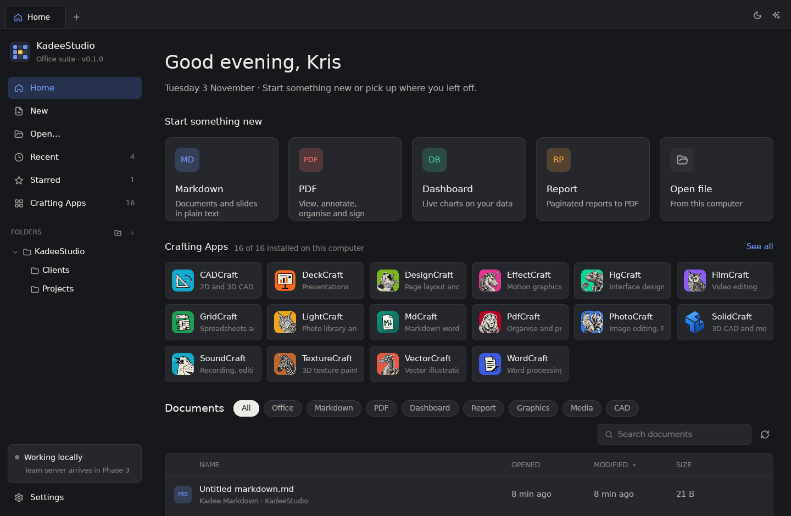
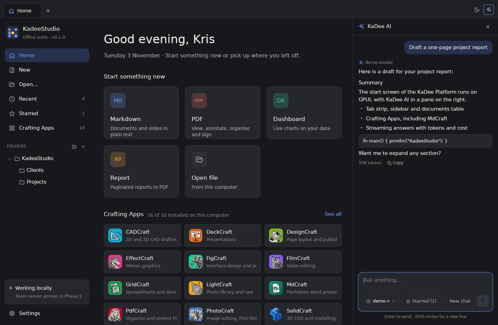

# KaDee Platform

A native office, creative and BI suite in Rust, drawn on the GPU with [GPUI](https://gpui.rs), with KaDee AI in every module. Native apps on macOS, Linux and Windows, a Docker stack for collaboration, SDKs, and AI.

**Status — v0.1.0: KadeeStudio's start screen, standalone ("Solo, no server").** The first screen of the platform, ported from KadeeStudio 0.3.1 (egui) to GPUI, with KaDee AI. The editors arrive module by module; the team server follows ("Team, docker compose").





## What 0.1.0 does

- **Tab strip**: Home and one tab per opened document (× or middle-click closes), a **+** menu for new documents (Markdown, PDF, dashboard, report, Word document, spreadsheet, slide deck, Open file…, Reopen closed tab), the theme switch (System → Light → Dark) and the ✦ **KaDee AI** button.
- **Sidebar**: the KadeeStudio logo and version, Home, **New**, **Open…**, Recent, Starred, Crafting Apps (with counts), **FOLDERS** — the documents folder and the folders you add, as a tree that remembers what is open, with **Add folder…**, **+** (new folder) and a **…** / right-click menu (New subfolder, Rename…, Show in folder, Delete folder…, Remove from list) — the *Working locally* card and **Settings**.
- **Greeting** with your name and the date.
- **Start something new**: Markdown, PDF, Dashboard, Report and Open file. Markdown, Dashboard and Report create a document in the documents folder (or the folder on screen) and open it in a tab.
- **Crafting Apps**: the installed ones, with their icons; click to start one. **See all** lists all sixteen — the fourteen ArtCraft apps, SolidCraft and **MdCraft** — with *Installed · version* or *Not installed*. They are found as the ArtCraft launcher finds them (the launcher's record, `/Applications`, `Program Files`, AppImages, `PATH`, Flatpak).
- **Documents table**: filter pills (All, Office, Markdown, PDF, Dashboard, Report, Graphics, Media, CAD), search, sortable Name / Opened / Modified / Size, a star and a **…** menu on hover (also on right-click): Open, Show in folder, Copy path, Star, Rename…, Duplicate, Remove from list, Delete file… (to the Trash, after asking). Missing files ask *File unavailable … Remove it from the list?*
- **Recent**, **Starred**, a **folder page** (its path as clickable steps, quick start into that folder, sub-folders, documents), the **New document** page and the **Crafting Apps** page.
- **File tab**: until the editors exist, a document opens in a tab with its details, a preview of text files, *Open in <Crafting App>* when one is installed (MdCraft for Markdown, PdfCraft for PDF, WordCraft …), *Open in default app*, *Show in folder*, *Star* and *Ask KaDee AI*.
- **KaDee AI** (✦, `Cmd+J` / `Ctrl+J`): a pane on the right, on Home a general chat (optionally answering from your **Starred** files), in a file tab a chat about that file. Streaming answers with **Stop**, **New chat**, a model picker, suggestions, light Markdown, tokens and cost per answer, Copy. Fourteen hosted providers (Anthropic, Gemini, OpenAI, Mistral, DeepSeek, Qwen, Kimi, GLM, Cohere, Meta, Microsoft Foundry, Grok, Aleph Alpha, Sakana), local Ollama and LM Studio, and any OpenAI-compatible endpoint.
- **Settings** (sidebar, `Cmd+,`): General (name, theme, documents folder), Keyboard (the shortcuts), **AI providers** (status, API key, endpoint, Test connection, on/off), **AI models** (the default model), About and the licences.
- **Keyboard**: everything is a command with a stable id; shortcuts are GPUI key bindings generated from kd-commands' key map, sequences included (`Cmd+N` then `M` makes a Markdown document). The menu bar has KadeeStudio, File, View, Window and Help.

## First launch

- Settings live in `be.Kadee.KaDeePlatform` (`~/Library/Application Support/…` on macOS, `~/.config/kadeeplatform` on Linux, `%APPDATA%\Kadee\KaDeePlatform\config` on Windows): `home.json` (settings), `library.sqlite3` (Recent and Starred) and `ai.toml` (KaDee AI). `KADEE_CONFIG_DIR` overrides the folder.
- **Coming from KadeeStudio 0.x?** The first launch imports its settings, Recent, Starred and KaDee AI providers and keys. KadeeStudio's own files are only read, so both can be used side by side.
- Documents go to `~/Documents/KadeeStudio`, created with *Welcome to KadeeStudio.md* when it is new.

## Build and run

Rust 1.88 or later.

```sh
cargo run -p kadee-studio --release
cargo test --workspace
```

- **macOS**: Xcode command-line tools (Metal).
- **Linux**: `libxkbcommon-dev libxkbcommon-x11-dev libwayland-dev libvulkan-dev libx11-xcb-dev libfontconfig-dev libfreetype-dev libzstd-dev libssl-dev` and a Vulkan driver (`mesa-vulkan-drivers`). Wayland and X11 both work.
- **Windows**: the MSVC toolchain (DirectX).

`--page=recent|starred|new|craft` opens that page first.

`Cargo.lock` pins `libc` to 0.2.188: GPUI 0.2.2 pulls in `xattr` 0.2, which does not build with later `libc` releases on Linux. Keep the lock file when updating.

## Code layout

```
kadee-platform/
├─ apps/
│  └─ kadee-studio/     GPUI desktop app: window, shell, Start screen, KaDee AI pane, Settings
├─ crates/
│  ├─ kd-commands/      every action as a Command with a stable id; key maps and sequences
│  ├─ kd-ui/            GPUI design tokens, light and dark themes, icons, text input, widgets
│  ├─ kd-ai/            KaDee AI: providers, catalogue, streaming chat, tools (from kadee-ai)
│  └─ kd-store/         catalogues, Recent/Starred (SQLite), home.json, file helpers (from kadee-core)
├─ assets/app-icon/     the KadeeStudio icon
└─ docs/                architecture notes and the roadmap
```

The rule from KadeeStudio carries over: core crates never depend on the UI (only `kd-ui` uses GPUI), and every click or shortcut becomes a `Command`. The remaining crates of the architecture (`kd-doc`, `kd-formats`, `kd-calc`, `kd-render`, `kd-sync`, `kd-plugin`, `kd-sdk`), the server and the SDKs arrive with the modules that need them — see [docs/ROADMAP.md](docs/ROADMAP.md).

## Licence

MIT OR Apache-2.0. Icons in the style of [Lucide](https://lucide.dev) (ISC). The Crafting App icons belong to their makers (see `apps/kadee-studio/assets/craft-icons/ATTRIBUTION.md`).
