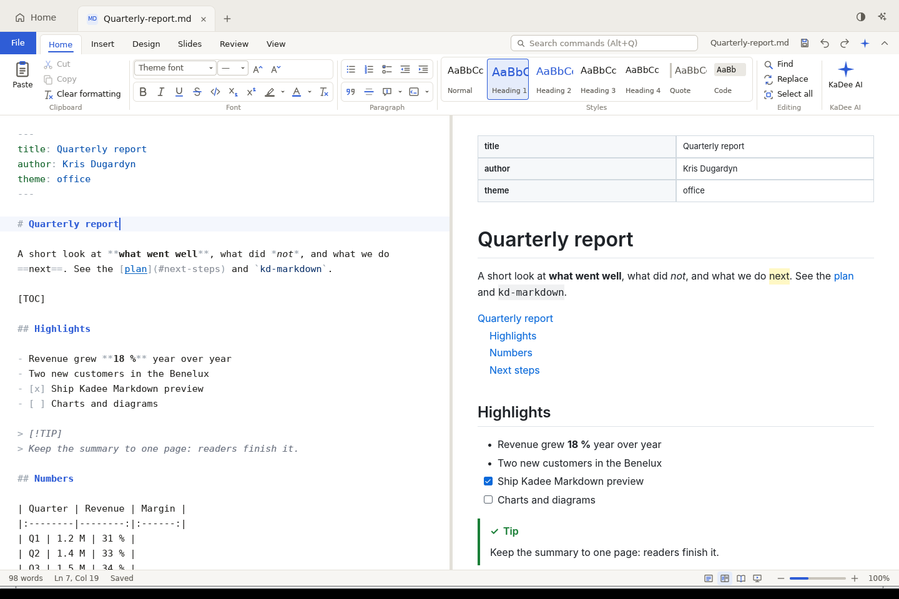
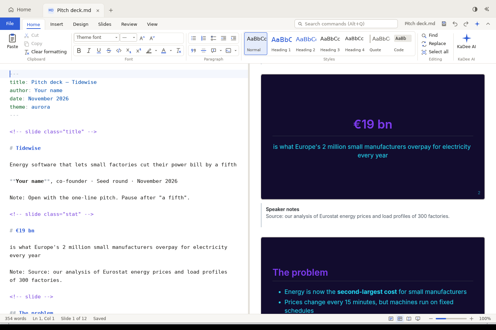

# KaDee Platform

A native office, creative and BI suite in Rust, drawn on the GPU with [GPUI](https://gpui.rs), with KaDee AI in every module. Native apps on macOS, Linux and Windows, a Docker stack for collaboration, SDKs, and AI.

**Status — v0.2 in progress: Kadee Markdown.** v0.1.0 brought KadeeStudio's start screen with KaDee AI, standalone ("Solo, no server"). v0.2 rebuilds MdCraft natively in GPUI: `.md` files now open in Kadee Markdown, with MdCraft's ribbon, a GPUI source editor, a native preview and KaDee AI in place of MdCraft's AI layer. The other editors arrive module by module; the team server follows ("Team, docker compose").






## Kadee Markdown (0.2, in progress)

- Opens every `.md` file in its tab: MdCraft's **ribbon** (File, Home, Insert, Design, Slides, Review, View and the contextual Table tab, with split buttons, menus and galleries), **command search**, a **source editor** with Markdown colours, a **native preview** side by side (Write / Split / Read), the **navigation pane** and the **status bar**.
- Every button is a command with MdCraft's id, label and shortcut; the ones not yet rebuilt say so.
- `Cmd+S` / `Ctrl+S` saves; tabs with unsaved changes show • and ask before closing.
- **KaDee AI** replaces MdCraft's AI layer: it reads the document as it is on screen (and the selection) and every answer can be **inserted into the document**.
- **File types**: `.md` and `.markdown` documents, `.mdd` document templates and `.mds` slide deck templates (New page › templates, File › Save as template).
- Find / Replace, Go to line, fonts and colours, slides with a full-screen slide show, charts and Mermaid flowcharts, pie, sequence and Gantt diagrams drawn natively, math as Unicode, print / PDF / HTML export, accessibility check.

## What 0.1.0 does

- **Tab strip**: Home and one tab per opened document (× or middle-click closes), a **+** menu for new documents (Markdown, PDF, dashboard, report, Word document, spreadsheet, slide deck, Open file…, Reopen closed tab), the theme switch (System → Light → Dark) and the ✦ **KaDee AI** button.
- **Sidebar**: the KadeeStudio logo and version, Home, **New**, **Open…**, Recent, Starred, Apps (with counts), **FOLDERS** — the documents folder and the folders you add, as a tree that remembers what is open, with **Add folder…**, **+** (new folder) and a **…** / right-click menu (New subfolder, Rename…, Show in folder, Delete folder…, Remove from list) — the *Working locally* card and **Settings**.
- **Greeting** with your name and the date.
- **Start something new**: Markdown, PDF, Dashboard, Report and Open file. Markdown, Dashboard and Report create a document in the documents folder (or the folder on screen) and open it in a tab.
- **Apps**: the installed ones, with their icons; click to start one. **See all** lists all sixteen — the fourteen ArtCraft apps, SolidCraft and **MdCraft** — with *Installed · version* or *Not installed*. They are found as the ArtCraft launcher finds them (the launcher's record, `/Applications`, `Program Files`, AppImages, `PATH`, Flatpak).
- **Documents table**: filter pills (All, Office, Markdown, PDF, Dashboard, Report, Graphics, Media, CAD), search, sortable Name / Opened / Modified / Size, a star and a **…** menu on hover (also on right-click): Open, Show in folder, Copy path, Star, Rename…, Duplicate, Remove from list, Delete file… (to the Trash, after asking). Missing files ask *File unavailable … Remove it from the list?*
- **Recent**, **Starred**, a **folder page** (its path as clickable steps, quick start into that folder, sub-folders, documents), the **New document** page and the **Apps** page.
- **File tab**: until the editors exist, a document opens in a tab with its details, a preview of text files, *Open in <app>* when one is installed (MdCraft for Markdown, PdfCraft for PDF, WordCraft …), *Open in default app*, *Show in folder*, *Star* and *Ask KaDee AI*.
- **KaDee AI** (✦, `Cmd+J` / `Ctrl+J`): a pane on the right, on Home a general chat (optionally answering from your **Starred** files), in a file tab a chat about that file. Streaming answers with **Stop**, **New chat**, a model picker, suggestions, light Markdown, tokens and cost per answer, Copy. Fourteen hosted providers (Anthropic, Gemini, OpenAI, Mistral, DeepSeek, Qwen, Kimi, GLM, Cohere, Meta, Microsoft Foundry, Grok, Aleph Alpha, Sakana), local Ollama and LM Studio, and any OpenAI-compatible endpoint.
- **Settings** (sidebar, `Cmd+,`), as in KadeeStudio 0.3.1 with **Cancel / Done**: General; **Keyboard** — record, clear, remove and add shortcuts (sequences included), reset to defaults; **AI providers** — **Add provider**, edit a provider (key, endpoint, default model, models, Test connection) and **Remove provider**; **AI models** — the default model and one per part of KadeeStudio; About and the licences.
- **Keyboard**: everything is a command with a stable id; shortcuts are GPUI key bindings generated from kd-commands' key map, sequences included (`Cmd+N` then `M` makes a Markdown document). The menu bar has KadeeStudio, File, View, Window and Help.

## First launch

- Settings live in `be.Kadee.KaDeePlatform` (`~/Library/Application Support/…` on macOS, `~/.config/kadeeplatform` on Linux, `%APPDATA%\Kadee\KaDeePlatform\config` on Windows): `home.json` (settings), `library.sqlite3` (Recent and Starred) and `ai.toml` (KaDee AI). `KADEE_CONFIG_DIR` overrides the folder.
- **Coming from KadeeStudio 0.x?** The first launch imports its settings, Recent, Starred and KaDee AI providers and keys. KadeeStudio's own files are only read, so both can be used side by side.
- Documents go to `~/Documents/KadeeStudio`, created with *Welcome to KadeeStudio.md* when it is new.

## Build and run

Rust 1.88 or later. For development:

```sh
cargo run -p kadee-studio --release
cargo test --workspace
```

`--page=recent|starred|new|craft` opens that page first.

### Installers

`./build.sh` builds for the system it runs on and puts everything in `dist/` (with a `.sha256` per file). Every script takes `--help`, `--run` (build, then start) and `--clean`.

| System | Command | Result |
|---|---|---|
| macOS | `./scripts/build-macos.sh` (`--universal` for Apple silicon + Intel, `--no-dmg`) | `KaDeePlatform.app`, `KaDeePlatform-0.1.0-macos-<arch>.dmg` |
| Linux | `./scripts/build-linux.sh` (`--tar-only`, `--target aarch64-unknown-linux-gnu`) | `.tar.gz` with `install.sh`; `.deb`, `.rpm` and AppImage when `dpkg-deb`, `rpmbuild`, `appimagetool` are installed |
| Windows | `.\scripts\build-windows.ps1` (`-Msi`, `-Arch arm64`) | portable `.zip`; `.msi` with the WiX CLI |

What each system needs:

- **macOS**: Xcode command-line tools. GPUI compiles its Metal shaders at build time with `xcrun metal`; without the Metal Toolchain (Xcode 26: `xcodebuild -downloadComponent MetalToolchain`) the script builds with runtime-compiled shaders instead (`--features runtime-shaders`). Signing and notarization: `APPLE_SIGNING_IDENTITY`, `APPLE_NOTARY_PROFILE`; otherwise the app is ad-hoc signed. `DMG_LAYOUT=0` makes a plain .dmg without the Finder layout (CI).
- **Linux**: `libxkbcommon-dev libxkbcommon-x11-dev libwayland-dev libvulkan-dev libx11-xcb-dev libfontconfig-dev libfreetype-dev libzstd-dev libssl-dev` (the script names any that are missing) and, to run, a Vulkan driver (`mesa-vulkan-drivers`). Wayland and X11 both work.
- **Windows**: Rust's MSVC toolchain and the "Desktop development with C++" workload (DirectX 11). For `-Msi`: `dotnet tool install --global wix` and `wix extension add --global WixToolset.UI.wixext`. Signing: `KADEE_SIGN_CERT`, `KADEE_SIGN_PASSWORD`.

The installers are named **KaDee Platform** (`KaDeePlatform.app`, package `kadee-platform`, `Program Files\KaDee Platform`, id `be.kadee.KaDeePlatform`), so they install next to KadeeStudio 0.x instead of replacing it; the app inside is still called KadeeStudio.

GitHub Actions: **CI** runs fmt, clippy, tests and a release build on all three systems; **Release** (run it by hand, or push a tag `v0.1.0`) builds the .dmg, .tar.gz/.deb/.rpm/AppImage and .zip/.msi and publishes them on a tag.

`Cargo.lock` pins `libc` to 0.2.188: GPUI 0.2.2 pulls in `xattr` 0.2, which does not build with later `libc` releases on Linux. The scripts build with `--locked`, so keep the lock file when updating.

## Code layout

```
kadee-platform/
├─ apps/
│  └─ kadee-studio/     GPUI desktop app: window, shell, Start screen, KaDee AI pane, Settings
├─ crates/
│  ├─ kd-commands/      every action as a Command with a stable id; key maps and sequences
│  ├─ kd-ui/            GPUI design tokens, light and dark themes, icons, text input, widgets
│  ├─ kd-ai/            KaDee AI: providers, catalogue, streaming chat, tools (from kadee-ai)
│  ├─ kd-doc/           a document's text, selection and grouped undo/redo
│  ├─ kd-formats/       Markdown (MdCraft's dialect): parsing, editing operations, highlighting, libraries
│  ├─ kd-markdown/      Kadee Markdown in GPUI: editor, preview, MdCraft's ribbon, commands and icons
│  └─ kd-store/         catalogues, Recent/Starred (SQLite), home.json, file helpers (from kadee-core)
├─ assets/app-icon/     the KadeeStudio icon
├─ scripts/             build-macos.sh, build-linux.sh, build-windows.ps1 (and build.sh at the top)
├─ packaging/           .desktop and AppStream files, the .dmg background, the WiX installer
└─ docs/                architecture notes and the roadmap
```

The rule from KadeeStudio carries over: core crates never depend on the UI (only `kd-ui` and the editor crates such as `kd-markdown` use GPUI), and every click or shortcut becomes a `Command`. The remaining crates of the architecture (`kd-calc`, `kd-render`, `kd-sync`, `kd-plugin`, `kd-sdk`), the server and the SDKs arrive with the modules that need them — see [docs/ROADMAP.md](docs/ROADMAP.md).

## Licence

MIT OR Apache-2.0. Icons in the style of [Lucide](https://lucide.dev) (ISC). The app icons belong to their makers (see `apps/kadee-studio/assets/craft-icons/ATTRIBUTION.md`).
